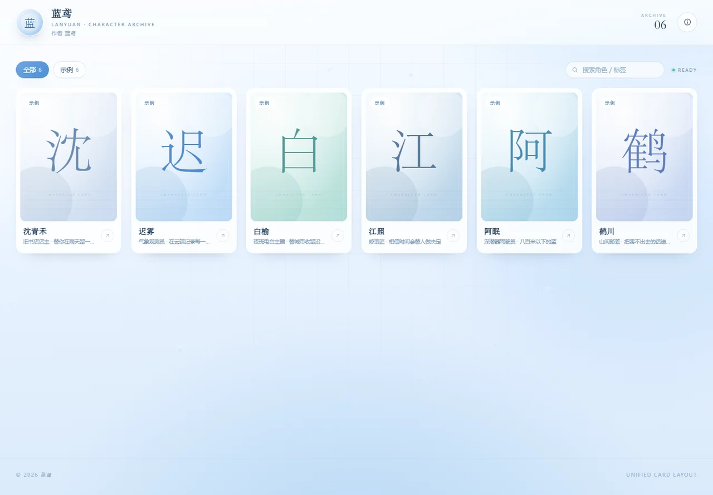
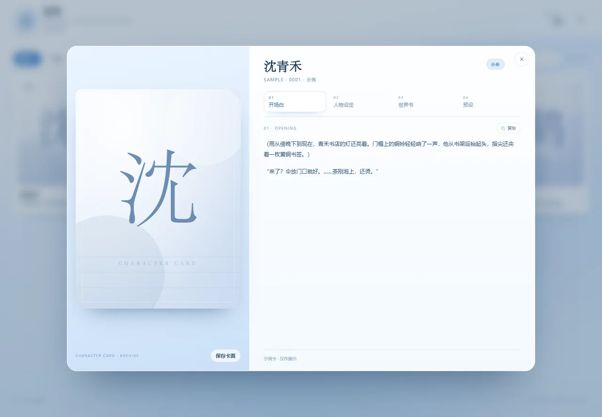
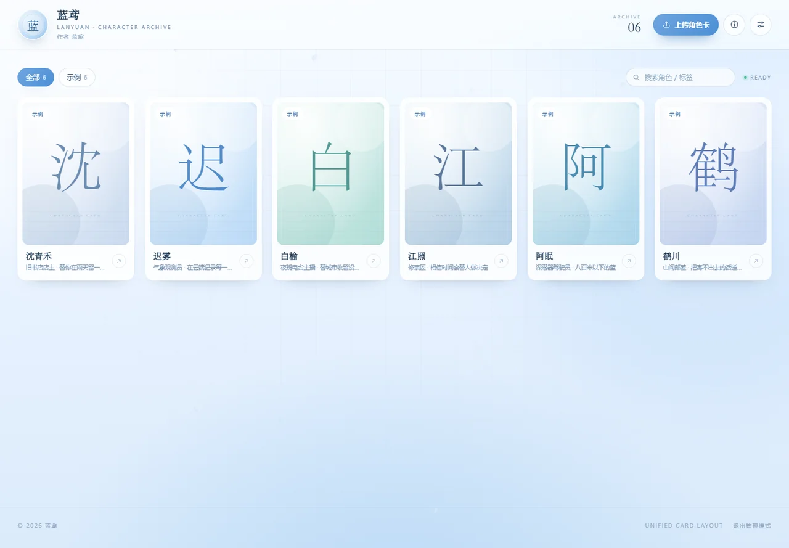

# 蓝鸢 · 角色卡档案馆

一个淡蓝色主题的个人角色卡档案馆。可以浏览角色卡、打开档案看「开场白 / 人物设定 / 世界书 / 预设」，也可以上传自己写好的角色卡，再导出成数据发布到网上。

纯静态网站：不需要服务器、不需要数据库，传到 GitHub Pages / Netlify 就能给别人看。





---

## 一、这个文件夹里有什么

| 文件 | 作用 | 需要改吗 |
| --- | --- | --- |
| `index.html` | 页面结构 | 一般不用 |
| `styles.css` | 颜色、字体、布局 | 改颜色时改这里 |
| `app.js` | 程序逻辑（读取卡片、弹窗、上传） | 一般不用 |
| `config.js` | **你的名字 / 作者 / 主人 / 头像 / 页脚** | 要改 |
| `cards.js` | **已发布的角色卡数据** | 上传后自动导出替换 |
| `preview/` | 预览图 | 可删 |

> 这个文件夹可以整个复制、改名，不影响使用。

---

## 二、先在本机看看

双击 `index.html`，用 Edge 或 Chrome 打开即可。

这时你看到的是**访客视角**：右上角没有「上传角色卡」，也没有「设置」按钮。

### 进「后台」（管理模式）

在网址后面加上 `?admin=1` 再回车：

- 本地：在地址栏的 `index.html` 后面加上 `?admin=1`
- 线上：`https://你的网址/?admin=1`

这时右上角会出现「上传角色卡」和「设置」，页脚会出现「退出管理模式」。建议把这个带 `?admin=1` 的网址**存成书签**，以后就从书签进。

管理模式下可以：

- 上传角色卡（存在你自己的浏览器里，刷新不丢）；
- 改用户名 / 作者 / 主人 / 头像 / 主题色；
- 导出 `config.js` 和 `cards.js` 发布。



点页脚的「退出管理模式」，就会回到访客视角；你本机还没发布的卡也会隐藏，方便检查公开效果。也可以直接把地址栏里的 `?admin=1` 删掉再回车，效果一样。

> 管理模式只跟网址有关，不会“记住”。网址里没有 `?admin=1`，就一定是访客视角。

> **分享给别人时，请用不带 `?admin=1` 的网址。** 带 `?admin=1` 的那个只留给自己做书签。

> 这是「把入口藏起来」，不是密码锁。静态网站没有后台，懂技术的人仍然可以改自己浏览器里的页面，但**改不了你 GitHub 上的文件**。真正的权限在你 GitHub 账号手里。

---

## 三、改成你自己的（名字 / 作者 / 主人 / 头像）

### 方法 A：在网页里改（推荐，不用碰代码）

1. 打开 `index.html?admin=1`（管理模式）；
2. 点右上角的「设置」图标（三个滑块的按钮）；
3. 改「用户名 / 作者 / 主人 / 简介 / 页脚」，点头像旁的「选择图片」换头像；
4. 点「应用预览」，页头会立刻变成你改的样子；
5. 点「导出 config.js」，浏览器会下载一个 `config.js`；
6. 用它**替换**网站文件夹里的 `config.js`，刷新页面 —— 以后所有访客看到的都是这个身份。

> 「主人」留空就不会显示。页头会显示成「作者 蓝鸢 · 主人 阿岚」这种格式。

### 方法 B：直接改 `config.js`

用记事本打开 `config.js`，改这几行后保存、刷新：

```js
window.__ARCHIVE_CONFIG__ = {
  siteTitle: '蓝鸢 · 角色卡档案馆',   // 浏览器标签页标题
  username: '蓝鸢',                  // 页头用户名
  english: 'LANYUAN · CHARACTER ARCHIVE', // 用户名下面的英文小字
  author: '蓝鸢',                    // 作者（页头 + 关于弹窗）
  master: '',                        // 主人，留空不显示
  bio: '这里收藏我写下的角色卡。',     // 作者简介
  avatar: '',                        // 头像：图片网址，或设置里上传后导出的长串
  accent: '#4b8fd6',                 // 主题色
  footer: '© 2026 蓝鸢',             // 页脚左边
  footerRight: 'UNIFIED CARD LAYOUT',// 页脚右边
  showDemo: true                     // 是否显示内置示例卡，发布前建议改成 false
};
```

注意：`config.js` 里写中文没问题，保存时选 **UTF-8** 编码。

---

## 四、改颜色 / 背景

打开 `styles.css`，最上面就是配色区：

```css
:root{
  --sky-top:#f7fbff;      /* 天空上方 */
  --sky-mid:#e9f3ff;      /* 天空中间 */
  --sky-bottom:#d9eafa;   /* 天空下方（淡蓝） */
  --ink:#17334f;          /* 主要文字 */
  --muted:#7895b3;        /* 次要文字 */
  --accent:#4b8fd6;       /* 主色：按钮、选中态 */
  --accent-deep:#2e6cae;
  --accent-soft:#dcebfa;
}
```

- 想更蓝一点：把 `--sky-bottom` 改成 `#c5e0fb`、`--sky-mid` 改成 `#dceeff`；
- 想更白一点：三个 `--sky-*` 都往 `#ffffff` 调；
- 主色也可以在网页「设置 → 主题色」里点选，导出 `config.js` 后永久生效。

改完记得 **Ctrl + F5** 强制刷新（浏览器会缓存 CSS）。

页头那行「LANYUAN · CHARACTER ARCHIVE」在 `config.js` 的 `english` 里改。

---

## 五、上传自己的角色卡

> 先进入管理模式（网址加 `?admin=1`），否则看不到上传按钮。

### 支持的文件

| 格式 | 说明 |
| --- | --- |
| `.png` | TAVO / SillyTavern 等带内嵌角色数据的 PNG 卡（文件里要有 `chara` 数据块） |
| `.json` | 角色卡 JSON（V1 / V2 / V3 规范都可以） |

直接把文件**拖进网页**，或点「上传角色卡」选择文件，支持一次选多张。

上传后会自动整理成四栏：

- **开场白** ← `first_mes` + `alternate_greetings`
- **人物设定** ← `description` / `personality` / `scenario` / `creator_notes`
- **世界书** ← `character_book.entries`
- **预设** ← `system_prompt` / `post_history_instructions` / `mes_example`

> 普通图片（没有内嵌数据的 PNG）会提示「这张 PNG 里没有角色卡数据」，这是正常的。

### 让访客也能看到：导出 `cards.js`

上传的卡只存在你的浏览器里。要发布给别人看：

1. 设置 → 数据与发布 → **导出 cards.js**；
2. 用下载到的 `cards.js` 覆盖文件夹里的同名文件；
3. 把整个文件夹重新上传到网站（或只覆盖 `cards.js`）；
4. 刷新网页，这些卡就变成「已发布」，所有人可见。

以后再上传新卡，重复一次「导出 → 覆盖」即可（每次导出都是完整的一份，直接覆盖）。

- 导出的图片会自动压缩成最长边 880px 的 WebP，体积小、加载快；
- 「下载原卡」只对本机上传的卡可用，已发布的卡下载的是压缩后的卡面图。

### 发布前检查清单

- [ ] `config.js` 里的用户名 / 作者 / 主人 / 头像 / 页脚都改好了；
- [ ] 想展示的卡都上传了，并导出、替换了 `cards.js`；
- [ ] 不想要示例卡的话，`showDemo` 改成 `false`；
- [ ] 本地刷新一次，确认页头、卡片、弹窗都正常；
- [ ] 去掉 `?admin=1` 打开一次，确认访客看不到上传 / 设置按钮；
- [ ] 再上传到 GitHub Pages / Netlify。

---

## 六、发布到网上

### 方式 A：GitHub Pages（免费，和你朋友的站一样）

1. 打开 [github.com](https://github.com/) 注册 / 登录；
2. 右上角 **+ → New repository**；
3. 填一个仓库名（例如 `my-cards`），选 **Public**，点 **Create repository**；
4. 在仓库页点 **Add file → Upload files**，把 `index.html`、`styles.css`、`app.js`、`config.js`、`cards.js` 一起拖进去，点 **Commit changes**；
5. 打开仓库的 **Settings → Pages**；
6. **Build and deployment → Source** 选 `Deploy from a branch`，**Branch** 选 `main` + `/ (root)`，点 **Save**；
7. 等 1～2 分钟，刷新 Settings → Pages，会看到网址：
   `https://你的用户名.github.io/my-cards/`

以后更新：回到仓库 → Upload files → 覆盖同名文件 → Commit，等 1 分钟即可。

> 如果仓库名取成 `你的用户名.github.io`，网址就是 `https://你的用户名.github.io/`。
> 仓库必须是 **Public**，私有仓库开 Pages 需要付费。

### 方式 B：Netlify Drop（不用 GitHub，拖一下就行）

1. 打开 [app.netlify.com/drop](https://app.netlify.com/drop)；
2. 把整个文件夹拖进页面；
3. 几秒后得到一个 `https://xxx.netlify.app` 网址，可以改成好记的名字。

### 方式 C：Cloudflare Pages

登录 Cloudflare → Workers & Pages → Create → Pages → Upload assets，拖入文件夹即可。

---

## 七、常见问题

**Q：打开网页看不到「上传角色卡」和「设置」按钮？**
你打开的是访客视角。在网址后加 `?admin=1` 回车即可，建议把这个网址存成书签。

**Q：别人能自己上传，或者改我的网站吗？**
不能。访客看不到管理入口，也没有你的 GitHub 账号；就算有人改自己浏览器里的页面，也只影响他自己，改不了你上传的文件。

**Q：我上传了卡，为什么朋友打开看不到？**
上传只保存在你自己的浏览器。按「导出 cards.js → 覆盖 → 重新上传」发布。

**Q：提示「这张 PNG 里没有角色卡数据」？**
这是普通图片，不是角色卡。需要用 TAVO / SillyTavern 等工具导出带数据的 PNG，或直接上传 JSON。

**Q：示例卡怎么删掉？**
两种方式：① 打开某张示例卡，点「移除示例卡」；② 把 `config.js` 里的 `showDemo` 改成 `false`（推荐，发布前做）。

**Q：改了名字 / 颜色，刷新又变回去了？**
网页里的「设置」只是预览；要点「导出 config.js」并替换文件，才会永久生效。

**Q：上传的卡会不会被别人看到 / 会不会传到服务器？**
不会。没有任何后端，数据只在你的浏览器或你上传的 `cards.js` 文件里。

**Q：换电脑 / 清浏览器数据后卡没了？**
本机的卡会丢；`cards.js` 里的已发布卡不会。建议定期导出 `cards.js` 当备份。

**Q：图片太大怎么办？**
导出时会自动压缩；如果单张卡特别大，可以先把 PNG 压到 2MB 以内再上传。

**Q：手机能看吗？**
可以，页面是响应式的；手机浏览器在管理模式下也能上传和修改。

**Q：想换字体 / 改布局？**
`styles.css` 顶部有 `--serif`（标题衬线字体）和 `--sans`（正文）两个变量，换成系统里已有的字体即可。

---

## 八、和原站的功能对照

| 原站 | 这个版本 |
| --- | --- |
| 页头头像 + 作者名 + 英文名 + 馆藏数 | ✅ 一样，名字 / 作者 / 主人 / 头像都能改 |
| 作者筛选 | ✅ 按作者自动生成筛选标签 |
| 角色卡墙 + 悬停「查看档案」 | ✅ 一样，另加搜索 |
| 档案弹窗：开场白 / 人物设定 / 世界书 / 预设 | ✅ 一样，四栏自动映射 |
| 下载角色卡 | ✅ 本机卡下载原图，已发布卡下载卡面 |
| — | ➕ 上传 PNG / JSON 角色卡、本地保存、导出发布 |
| — | ➕ 管理模式：访客看不到上传 / 设置入口 |
| — | ➕ 关于作者弹窗、手机适配、示例卡 |

这个版本是按原站的使用方式重新实现的，**不包含原站的任何角色卡、图片或数据**。请使用你自己写 / 你有权使用的角色卡。

---

## 九、给想继续改的人

- 角色卡数据格式：`cards.js` 里就是 `window.__ARCHIVE_CARDS__ = [{ name, role, tags, creator, createdAt, sections:{opening,setting,worldbook,preset}, image }]`；
- 想批量导入：可以自己生成同样结构的 `cards.js`，`image` 填图片网址或 `data:image/...`；
- 页面结构在 `index.html`；弹窗、渲染、上传逻辑在 `app.js` 里都有中文注释；
- 浏览器要求：Chrome / Edge / Safari 15+（需要支持 IndexedDB）。
